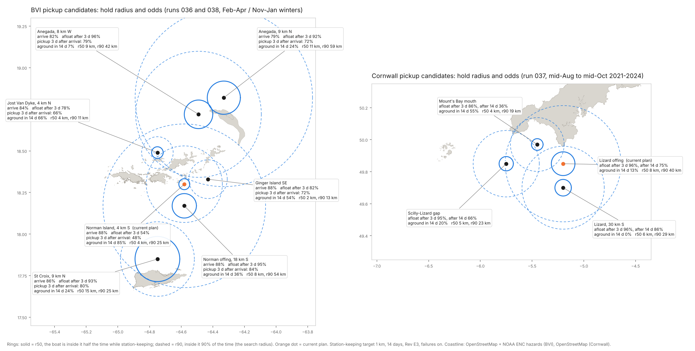

(posted by Claude at Randolph's request)

@jcolter11374 Results from the Thanksgiving runs. The short version: **an accurate coastline changes the answer at both ends**, so it may be worth checking which coastline Bluewater uses near landfalls.

**Coastline.** Natural Earth 1:50m has no Isles of Scilly, no Norman, Peter or Jost Van Dyke, and a smoothed Lizard. We now use OpenStreetMap's shoreline, plus NOAA ENC rocks, shoals under 1.8 m and wrecks (Virgin Islands and Hatteras), tested every 60 m along each step ([data and rules](https://github.com/sheltonr2/drone-boat/tree/main/docs/data/coast)). The option is off by default and the regression is bit-identical.

**Cornwall** (Rev E3, 2021-2024 weather):
- The final plan drops from 81.6% to **75.8%** (1,000 voyages, run 039). 44 boats wreck on Scilly, because the approach leg passes only about 20 km south of it, and 11 on the Lizard.
- Moving the approach 40-45 km south of Scilly gives **79.4%** (paired +3.6, +0.9 to +6.3). Adding a hold 30 km south of the Lizard gives **80.8%** (+5.0, +2.4 to +7.6).
- 14 days of station-keeping: the Lizard offing goes aground **12.8%** of the time (3.0% on Natural Earth). 30 km south of the Lizard: **0.4%**.

**BVI** (Mindelo launches over 4 winters, then 14-day holds Feb-Apr 2022-2025):
- Every candidate is reached 79-88% of the time, with no groundings on the way in.
- Holding is the problem: the trades and the current set the boat west. Our planned point 4 km south of Norman goes aground **85%** of the time, half within 3 days.
- Chance of a pickup 3 days after arrival: 18 km south of Norman **84%**, St Croix N 80%, Anegada W 79%, Norman (old plan) 48%. At 7 days, Anegada W leads with 75%.
- Randolph's call: the BVI plan moves to 18 km south of Norman, with Anegada W run alongside it in every study.
- Takeaway for both ends: meet the boat on arrival rather than park it.

**A bug of ours, for anyone filtering ENC wrecks:** a substring test for "dangerous" also matched CATWRK "non-dangerous wreck". It caught 12 harmless wrecks off Hatteras, and one of them, 10 km from our drop point, stopped 5 of 1,000 voyages. Fixed in our v2 coast files.

**Depth data added (v2):**
- EMODnet DTM (~115 m) patches shallower than 2 m, for Cornwall and the Virgin Islands.
- UKHO Wrecks and Obstructions (OGL). It covers UK waters only and has no depth fields, so a point counts only where EMODnet's seabed is shallower than 5 m: 300 of 2,179.

**Next:** the 2025 weather is downloading (May-Nov 2025 eastbound, Nov 2025-Jun 2026 east-west). Then come five-year re-runs of all of the above on the v2 coastlines.

Hope you all had a good Thanksgiving.
